# ATL Housing: Households Served

## Manual workshop attendee workbook

**Build it yourself in Microsoft Fabric | Browser-first | Two-day lab**

Edition 1.0, November 11, 2026 UTC. Based on the supplied ATL Housing execution
guide, draft v0.4. Screenshots are from the actual ATLhousing reference environment;
they are not mockups. Fabric menus can change; identify controls by their labels.

**What you will build:** original Excel landing, metadata-driven SQL ingestion,
typed Warehouse staging, dimensional transformations, an explicit Direct Lake
model, the HT1-HT10 report, Spark DQ and a monitored master pipeline.

**This is a manual build, not an automation quick start.** You will click the
Fabric controls, create each item, enter settings and paste the supplied SQL,
Power Query, DAX and notebook cells yourself. Do not run `deploy*.py`, the data
generator or the source loader.

> **Protect the reference build.** Build only in the participant workspace assigned
> by the instructor. The shared `ATLhousing` workspace shown in screenshots already
> contains the reference solution. If you have not been assigned a separate build
> workspace, use the inspection track: open items, compare settings and run
> read-only checks, but do not save changes, reload tables or start pipelines.

## How to use this workbook

1. Extract the companion lab ZIP before starting; do not open files inside the ZIP.
2. Keep this PDF or Word document open beside Fabric. The offline HTML version has
   clickable local asset links; the PDF/Word links also have private-repository
   equivalents. If a link is unavailable, open the printed file path in Notepad.
3. Use `workshop-assets` for copy-and-paste content and `data\excel` for the
   unchanged original workbooks supplied in the distribution pack.
4. Finish each module's **Check / Stop / Catch-up** before continuing.
5. Record your own resource IDs and run IDs. Values in screenshots identify the
   reference environment, not values to copy into a different participant workspace.
6. Ask the instructor before changing permissions, enabling a schedule, sending an
   alert, applying a label, creating workspaces or changing source configuration.

No Azure capacity purchase, source restore, SQL source reload, source-row update
or public GitHub Pages publishing is part of the attendee build.

### Suggested two-day sequence

| Day | Modules | Work product |
|---|---|---|
| 1 morning | M1-M3 | Access, landing, connections, schemas and control/staging tables |
| 1 afternoon | M4-M7 | SQL and Excel ingestion, transforms and base master pipeline |
| 2 morning | M8-M10 | Date dimension, Direct Lake, measures, RLS configuration and report |
| 2 afternoon | M13, return to M7 | Spark checks, final reconciliation/framing and accepted master run |
| Presenter/admin sessions | M11, M12, M14 | Conditional zero-copy, governance, DevOps and Databricks modules |

M13 is deliberately completed before the **final** M7 acceptance run. The report's
DQ page is created in M10 and receives actual run results in M13.

### Your resource worksheet

Complete the right-hand column with the instructor. Never substitute an
unrelated existing connection just because it is visible.

| Setting | Reference / required value | Your assigned value |
|---|---|---|
| Tenant/account | Approved workshop tenant; organizational account | __________________ |
| Build workspace | Instructor assigns an isolated participant workspace | __________________ |
| Workspace ID | Reference only: `4d77b5c8-d96f-41df-83e1-954c582336d8` | __________________ |
| Capacity | Existing approved capacity; reference is F8, West US 3 | __________________ |
| SQL server | `sql-atlhousing.database.windows.net` | __________________ |
| Source database | **ATLHousing**, schema **hs** | ATLHousing |
| Source access | Read-only for the workshop; no destructive loader | Confirmed: ______ |
| Storage | `fabridemo`, container `atldemo` | Confirmed: ______ |
| Lakehouse | `LH_ATL_Landing` in your workspace | ID: ______________ |
| Warehouse | `WH_ATL_HS` in your workspace | SQL endpoint: ____ |
| Approved Excel batch | Instructor assigns a unique folder/batch name | __________________ |
| Semantic model | `SM_HouseholdsServed` in your workspace | ID: ______________ |
| Viewer/program map | Approved identity and allowed program codes | Pending / ________ |
| Fiscal calendar / label | Business-approved values only | Pending / ________ |
| Alert / schedule | Approved destination and enablement decision | Pending / ________ |

### Important corrections to the draft execution guide

| Draft shorthand | Use in this workshop |
|---|---|
| Example source database name | The user-approved source is **ATLHousing** |
| Approximate source counts | Use the verified count table in M4, not approximate draft numbers |
| Unit.PropertyKey | Source Unit has **PropertyID**; resolve the dated property version |
| FamilyMember.MemberKey | Source FamilyMember uses **HouseholdID**; do not join it to every snapshot |
| Summarized supportive totals | Original roster columns are ReportMonth, HouseholdID, Program, SupportType |
| Global staging truncate first | Do not globally truncate; use current-run landing and transactional publication |
| Distinct household count | Preserve household-program-month observations, including second-program records |
| Hide source personal columns | Exclude unnecessary columns from the model; hiding is not security |
| All guide modules already accepted | Core data/report works; security, alerts, schedules and presenter modules have explicit gates |

## M1. Sign in, inspect the kit and confirm access

**Objective:** start with the correct tenant, approved existing resources and
readable original data. **Prerequisite:** instructor-assigned workspace and access.

1. Open `https://app.fabric.microsoft.com` in Edge or Chrome.
2. Sign in with the approved workshop organizational account. If an account picker
   appears, choose the workshop tenant, not a personal or unrelated work account.
3. Select **Workspaces**, then your assigned workspace. Confirm its name with the
   instructor before creating or editing anything.
4. Open **Workspace settings** and inspect the license/capacity assignment. Do not
   start a trial, resize a capacity or create a new paid resource as a workaround.
5. Confirm that you can create Fabric items and that the source SQL connection
   can be used or created. Contributor/Member authoring access is not a Viewer
   RLS test. On the reference F8, confirm appropriate Power BI Pro/PPU or an
   approved existing trial for report authoring/Viewer consumption; the Fabric
   capacity alone is not a free report-viewer license.
6. In the extracted lab pack, open `data\excel`. Confirm 24 `.xlsx` files:
   12 `UnitAvailability_YYYYMM.xlsx` and 12 `SupportiveHousing_YYYYMM.xlsx`,
   covering January-December 2025.
7. Open a sample of each workbook type in Excel. The UnitAvailability sheet is
   `UnitAvailability`; the supportive sheet is `Roster`. No password should be
   requested. Close without saving changes.
8. Use the readable originals from the kit. The original storage `excel/` blobs
   in this environment were encrypted; do not overwrite them or attempt to remove
   their encryption. A password prompt is a **Stop**, not a reason to regenerate data.
9. Keep source SQL and storage read-only. CSVs are controls/bootstrap alternatives;
   they are not a second feed to append on top of SQL.

**Check:** correct workspace, authorized source access, 24 readable originals.
**Stop:** missing access, an unexpected tenant, encrypted files or production data.
**Catch-up:** instructor supplies access and the original kit; no regeneration.

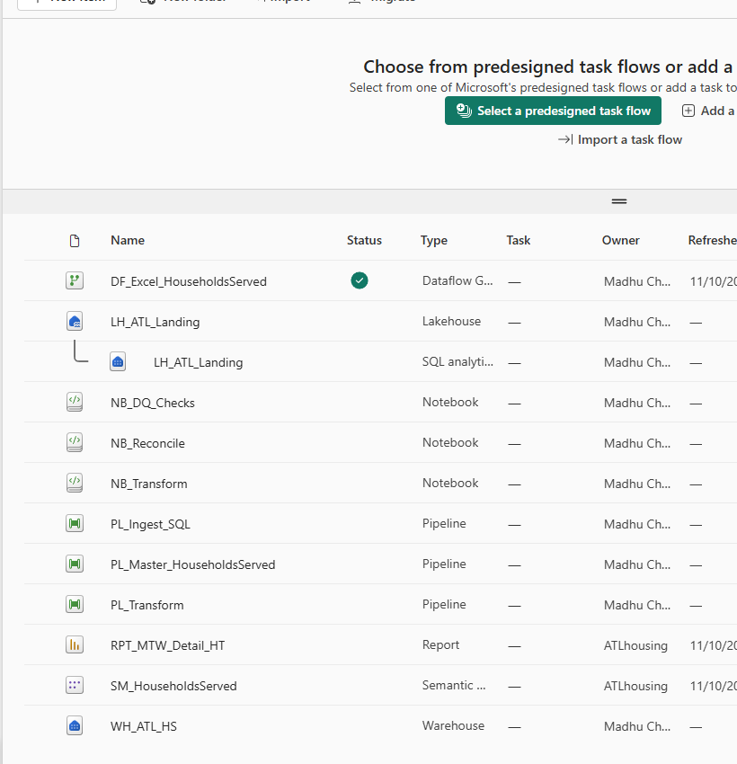

*Figure 1. Reference workspace after the build. Your participant workspace starts
empty. Use New item to create each artifact in the following modules.*

## M2. Create the Warehouse, Lakehouse and manual Excel landing

**Objective:** create your destination objects without altering the source.

1. In your assigned workspace, select **New item**. Search for **Warehouse**,
   select it, enter `WH_ATL_HS` and choose **Create**.
2. Return to the workspace. Select **New item > Lakehouse**, name it
   `LH_ATL_Landing` and choose **Create**. Use the default supported Lakehouse
   options unless your instructor has provided a different configuration.
3. Open the Lakehouse. In **Explorer**, expand **Files**.
4. From the Files folder menu, choose **New subfolder** and create `landing`.
   Inside it create `excel`, then the unique approved batch folder from your worksheet.
5. Open that batch folder. Use **Upload > Upload files**, select all 24 original
   `.xlsx` files from `data\excel`, and wait for every upload to complete.
6. Confirm the folder contains all 24 workbooks, with the original filenames.
   Do not place a second copy in nested folders or combine previous batches.
7. Record the Lakehouse ID. Open its URL or use the item details/link: the ID is
   the GUID identifying the Lakehouse, not the workspace GUID.
8. Record the workspace ID separately. You will use both values in M4 and M5.
9. Only an authorized administrator assigns approved Entra groups through
   **Manage access**. Do not create the draft guide's suggested groups or grant
   roles to guessed identities.

**Check:** one Warehouse, one Lakehouse, exactly 24 originals in
`Files\landing\excel\<your-approved-batch>`.
**Stop:** the current folder is the shared reference Lakehouse or an old batch.
**Catch-up:** inspect the reference folder with the instructor; do not replace it.

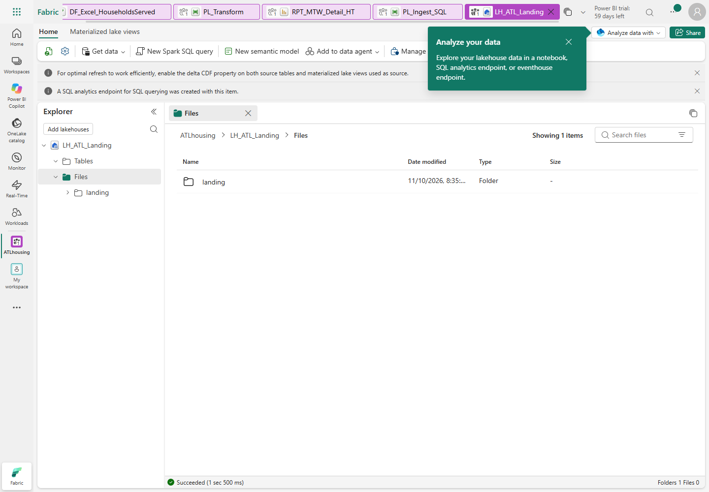

*Figure 2. Start from Files and create folders before uploading; Tables is a different area.*


*Figure 3. Reference batch of original workbooks. Use your own folder/batch ID.*

## M3. Create connections, schemas, metadata and staging tables

**Objective:** prepare the destination and an approved organizational SQL connection.

### M3.1 Connect to the existing SQL source

1. Open the Fabric **Settings** gear and **Manage connections and gateways**.
2. If the instructor has shared the dedicated approved SQL connection, select and
   test that connection. Otherwise select **New > Cloud**.
3. Enter connection name `ATL_HS_SQL_Source` (or your instructor-assigned unique name).
4. Choose the supported SQL Server/Azure SQL connection type offered by the dialog.
   The pipeline source connector in M4 is **Azure SQL Database**.
5. Enter server `sql-atlhousing.database.windows.net` and database **ATLHousing**.
6. Choose **Organizational account / Microsoft Entra ID**, sign in with the approved
   workshop account, and use an encrypted connection. Do not choose an unrelated
   gateway or copy another person's connection credentials.
7. Set privacy level **Organizational** where offered. Do not select **Skip test
   connection**. Test and create the connection.
8. If you lack connection-creation or sharing rights, stop for the administrator.
   Do not fall back to a SQL password, storage key or SAS token.

### M3.2 Execute the destination SQL manually

1. Return to your workspace and open **WH_ATL_HS**.
2. Select **New SQL query**. Verify that the selected database is the **Fabric
   Warehouse WH_ATL_HS**, not the source Azure SQL database.
3. Open [01_foundation.sql](workshop-assets/01_foundation.sql) in Notepad. Copy its
   complete contents into the Fabric SQL editor and choose **Run**.
4. Open a new query and repeat with
   [02_source_staging.sql](workshop-assets/02_source_staging.sql).
5. Repeat with [03_transform_procedures.sql](workshop-assets/03_transform_procedures.sql).
   This creates procedures; do not execute the fact loaders before ingestion.
6. If your editor does not accept `GO`, run the blocks between `GO` separators
   individually, in order. Never remove validation or exception handling.
7. Refresh **Explorer > Schemas**. Inspect `stg`, `prd` and `mtd`.
8. Confirm the ten source staging tables plus `stg.AnswerKey`, the two Excel staging
   tables, control tables, `prd.DQ_Results` and the stored procedures.
9. Run the following query in the Warehouse:

```sql
SELECT SourceSchema,SourceTable,TargetTable,LoadType,WatermarkColumn,IsActive
FROM mtd.TablesToCopy ORDER BY SourceTable;
```

10. Expect ten active `Full` entries. Watermarks are NULL: this workshop does full
    loads, not a falsely advertised incremental Member load.
11. Copy the Warehouse's **SQL connection string** from its settings/Home command.
    Record only the server hostname as `WAREHOUSE_SQL_ENDPOINT`; notebook cells
    must not contain a whole connection string or an Azure SQL source hostname.

**Check:** ten active metadata entries, correctly typed empty destination tables,
and four relevant procedures including `mtd.usp_LogRun`.
**Stop:** a SQL editor points to `ATLHousing` while you are about to execute DDL.
**Catch-up:** paste the same reviewed SQL files manually into your assigned Warehouse.

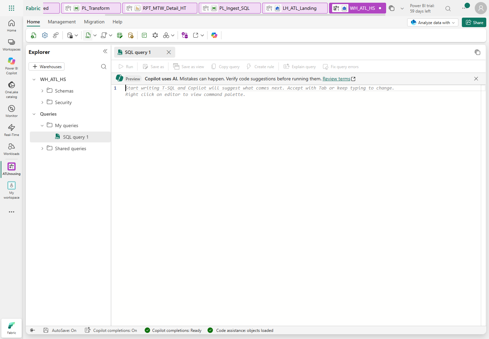

*Figure 4. New SQL query is the manual execution surface. Refresh Explorer after DDL.*

## M4. Build the metadata-driven SQL pipeline manually

**Objective:** SQL SELECTs -> immutable run-scoped Parquet -> transactional staging.
This deliberately avoids the draft's global truncate-first pattern.

### M4.1 Create the Lookup and ForEach

1. Return to the workspace. Select **New item > Pipeline**, name it `PL_Ingest_SQL`.
2. On the activity ribbon add **Lookup**. In **General**, set its name to
   `Lookup active full-load tables`.
3. Open **Settings**. Select your `WH_ATL_HS` Warehouse connection, choose **Query**,
   and paste [lookup.sql](workshop-assets/expressions/lookup.sql).
4. Clear **First row only**. If you preview, expect ten rows and the three columns
   SourceSchema, SourceTable and TargetTable.
5. Add **ForEach**, named `ForEach SQL table`.
6. Drag the Lookup's green **On success** connector to the ForEach.
7. Select ForEach > **Settings**. Leave **Sequential** unchecked, set **Batch count**
   to `4`, and use **Add dynamic content** for Items:

```text
@activity('Lookup active full-load tables').output.value
```

8. Keep these exact activity names: later expressions refer to them literally.
9. Set activity retries to `0` for this controlled lab. Do not configure overlapping runs.

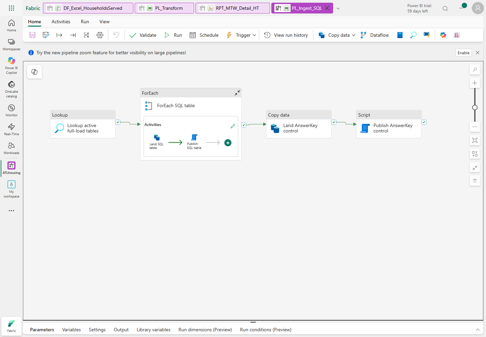

*Figure 5. The control AnswerKey copy is outside the ten-table ForEach.*

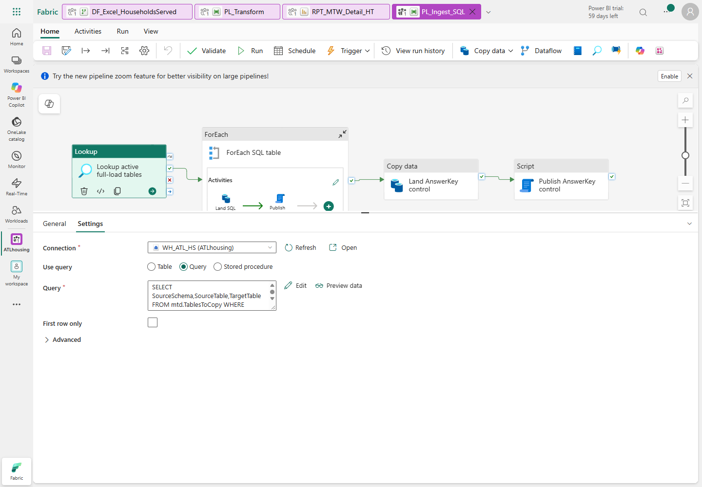

*Figure 6. Select Query and clear First row only; the full query is in the asset file.*

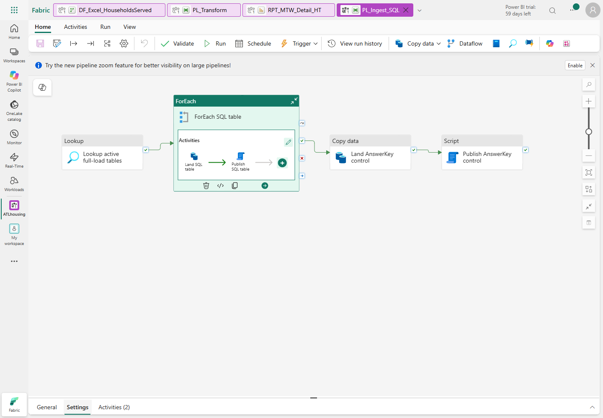

*Figure 7. Items must be the Lookup output array; the batch count is 4.*

### M4.2 Add the two nested activities

1. Select the ForEach, open its **Activities** tab, then choose the pencil/**Edit**
   control. You are now editing inside the loop.
2. Add **Copy data**, named `Land SQL table`.
3. In **Source**, choose the dedicated `ATL_HS_SQL_Source` connection and the
   **Azure SQL Database** source type. Select **Query**.
4. Choose **Add dynamic content**, open
   [sql-source-query.txt](workshop-assets/expressions/sql-source-query.txt), and
   paste the expression, not a quoted string containing the expression.
5. In **Destination**, choose your `LH_ATL_Landing`, root folder **Files**.
6. Set folder-path dynamic content to:

```text
@concat('landing/native_sql/',pipeline().RunId)
```

7. Set file-name dynamic content to:

```text
@concat(item().TargetTable,'.parquet')
```

8. Choose file format **Parquet**, compression **Snappy**. Do not use a historical
   folder wildcard or a fixed run ID.
9. Keep schema-based mapping/type conversion enabled where offered. Do not allow
   data truncation, and do not invent column mappings between different names.
10. Add **Script**, named `Publish SQL table`, after Copy on **On success**.
11. Select the destination **WH_ATL_HS** connection. Add a **NonQuery** script.
12. Open [publish-sql-table.txt](workshop-assets/expressions/publish-sql-table.txt)
    in Notepad. Replace `<WORKSPACE_ID>` and `<LAKEHOUSE_ID>` with your worksheet
    GUIDs. Verify that no angle-bracket placeholder remains.
13. Paste the entire expression through **Add dynamic content** in the script
    text field. Do not paste it as literal SQL or replace `pipeline().RunId` with
    an old value.
14. The expression performs a destination transaction: DELETE the matching staging
    table, COPY the exact current-run Parquet, compare count with Copy rowsRead,
    COMMIT, then log success. Errors roll back and rethrow.
15. Select the `PL_Ingest_SQL` breadcrumb to return to the parent canvas.

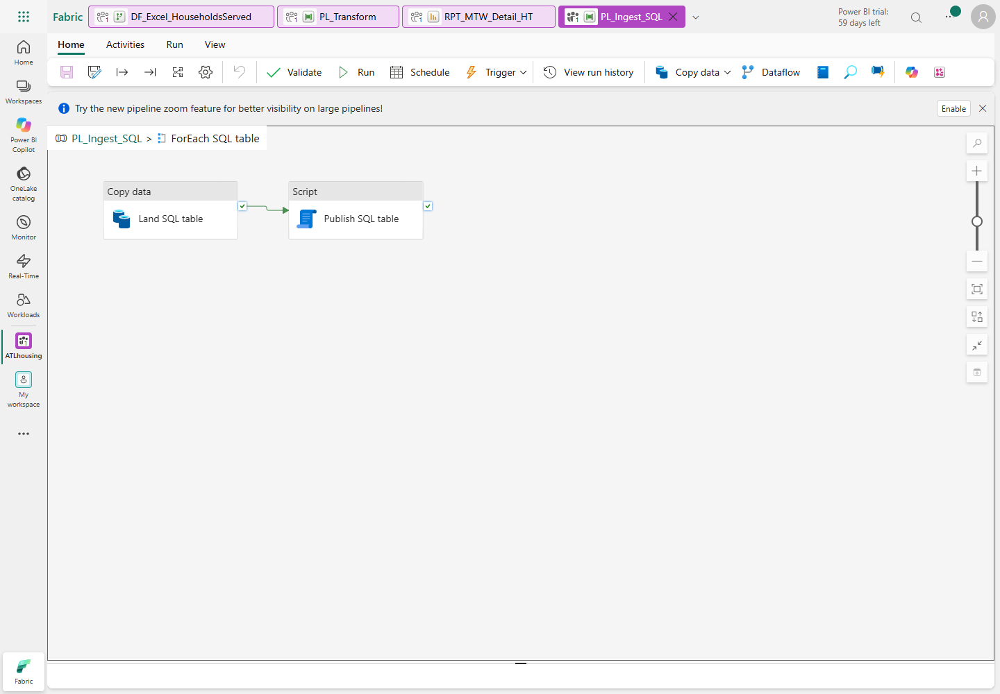

*Figure 8. Copy must succeed before the current table is published.*

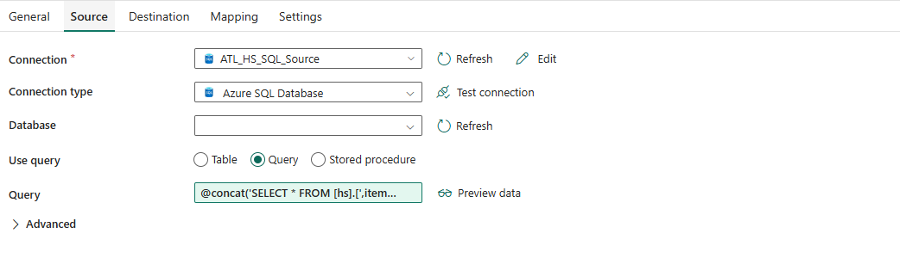

*Figure 9. Use the approved source connection and an allowlisted metadata table name.*

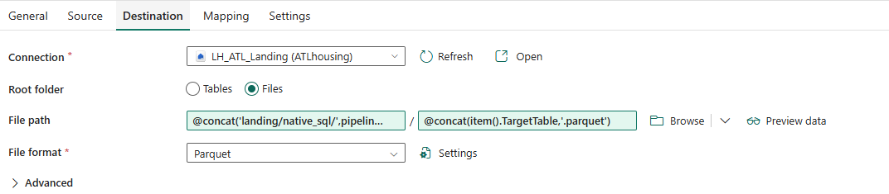

*Figure 10. Run-scoped paths prevent re-ingestion of historical batches.*

### M4.3 Copy AnswerKey separately and test

1. Outside ForEach, add **Copy data**, named `Land AnswerKey control`.
2. Connect ForEach **On success** to this activity.
3. Source: same approved SQL connection; literal query
   `SELECT * FROM [hs].[AnswerKey]`.
4. Destination: same Lakehouse Files root and current-run folder expression;
   file name **AnswerKey.parquet**, format Parquet/Snappy.
5. Add **Script**, named `Publish AnswerKey control`, after it on success.
6. Select **WH_ATL_HS**, NonQuery, and paste the reviewed expression from
   [publish-answer-key.txt](workshop-assets/expressions/publish-answer-key.txt).
   Replace both workspace/Lakehouse placeholders first.
7. Choose **Validate**, correct every error, then **Save**.
8. Ensure no other publisher/master is running. Choose **Run** and open
   **View run history** or **Monitor**.
9. Wait for terminal **Succeeded**. Open the ForEach details and inspect all ten
   copies/publications plus both control activities. Submission is not completion.
10. In the Warehouse, run `SELECT COUNT_BIG(*) FROM stg.<table>` for each table.
    Compare with the fixed-source counts below; counts are not business metrics.

| Source/staging table | Expected rows |
|---|---:|
| SourceSystem | 2 |
| ProgramType | 9 |
| VoucherType | 5 |
| ActionType | 5 |
| IncomeSource | 6 |
| Property | 127 |
| Unit | 25,794 |
| UnitLocation | 25,794 |
| Member | 240,819 |
| FamilyMember | 48,021 |
| AnswerKey, control only | 108 |

**Check:** every source table and AnswerKey loaded; inspect the current run's files.
**Stop:** partial failure, wrong target connection, any mismatched count or another active publisher.
**Catch-up:** correct the setting and rerun this pipeline serially; never append CSV data.

## M5. Create the real Excel Dataflow Gen2

**Objective:** read only your approved original-file batch and replace both typed
Excel staging tables. Do not infer completion from a query preview.

### M5.1 Parameters and four manual queries

1. Select **New item > Dataflow Gen2**. Name it `DF_Excel_HouseholdsServed`.
   Use the current supported Gen2 experience offered by your tenant.
2. Open **Home > Manage parameters > New parameter**. Create these required Text
   parameters with current values from your worksheet:

| Parameter name | Current value |
|---|---|
| pWorkspaceId | Your participant workspace GUID |
| pLakehouseId | Your participant Lakehouse GUID |
| pApprovedBatch | Your exact approved batch-folder name |

3. Choose **Get data > Blank query**. Open **Advanced editor**, replace its contents
   with [WorkbookRows.pq](workshop-assets/power-query/WorkbookRows.pq), select
   **Done**, and name the query `WorkbookRows`.
4. Repeat for [CurrentBatch.pq](workshop-assets/power-query/CurrentBatch.pq),
   naming it `CurrentBatch`.
5. When prompted for the OneLake Data Lake connection, select **Organizational
   account** and the approved tenant account. The URL must point to your own
   `Files/landing/excel/<batch>` path. Use Organizational privacy; no account keys.
6. Repeat for [UnitAvailability.pq](workshop-assets/power-query/UnitAvailability.pq),
   naming it `UnitAvailability`.
7. Repeat for [SupportiveHousing.pq](workshop-assets/power-query/SupportiveHousing.pq),
   naming it `SupportiveHousing`.
8. Do not add destinations to parameters, the function or CurrentBatch. Only the
   final two table queries have destinations.
9. Inspect availability preview: 72 rows, six columns, integer unit counts and
   EffectiveDateKey; SourceFile must retain the original filename.
10. Inspect supportive query schema: EffectiveDateKey integer; HouseholdID,
    Program, SupportType and SourceFile text. The actual original roster has
    20,752 rows; it does not contain pre-aggregated VASH/Other columns.

The function validates worksheet names, expected columns and ReportMonth against
the filename. It computes SheetName before navigating Excel.Workbook, avoiding
the `Kind` argument-shadowing issue encountered during the reference build.

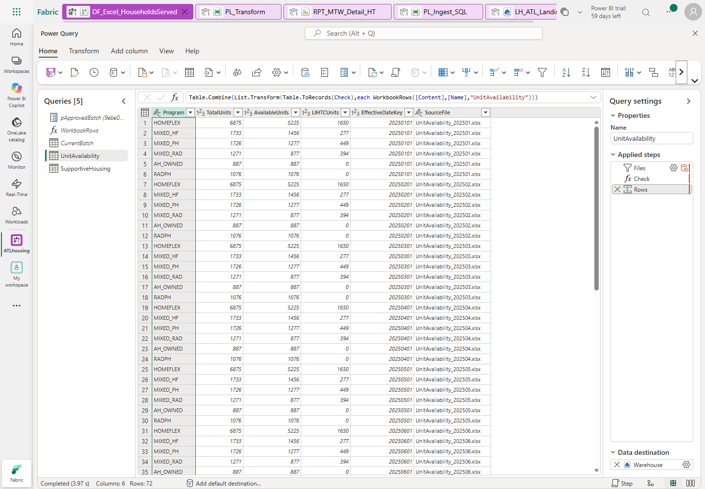

*Figure 11. The reference build shows five queries because its workspace/Lakehouse
IDs were fixed. Your portable manual build adds the two ID parameters above.*

### M5.2 Configure both existing destinations

1. Select **UnitAvailability** and **Add data destination > Warehouse**.
2. Select/create the approved organizational Warehouse connection.
3. Select **your workspace > WH_ATL_HS > stg > UnitAvailability**.
   Choose the existing table, not a newly invented default table name.
4. Advance to destination settings. Select update method **Replace**.
5. Use manual column mapping; do not let the wizard recreate or alter the table:

| Query column | Destination column | Type |
|---|---|---|
| EffectiveDateKey | EffectiveDateKey | Integer |
| Program | Program | Text |
| TotalUnits | TotalUnits | Integer |
| AvailableUnits | AvailableUnits | Integer |
| LIHTCUnits | LIHTCUnits | Integer |
| SourceFile | SourceFile | Text |

6. Confirm the destination. Select **SupportiveHousing** and repeat for existing
   `WH_ATL_HS.stg.SupportiveHousing`, also **Replace**.
7. Map EffectiveDateKey, HouseholdID, Program, SupportType and SourceFile to the
   same-named destination columns. Keep HouseholdID as text.
8. Choose **Save & run**, or **Publish** then **Refresh** if those are the labels
   offered by your Gen2 version.
9. Open **Recent runs**. Wait for the actual refresh to finish successfully for
   both destinations. A successful preview is not a successful load.
10. In the Warehouse run:

```sql
SELECT COUNT_BIG(*) AS AvailabilityRows FROM stg.UnitAvailability; -- 72
SELECT COUNT_BIG(*) AS SupportiveRows FROM stg.SupportiveHousing; -- 20752
SELECT EffectiveDateKey,Program,COUNT(*) AS N
FROM stg.UnitAvailability GROUP BY EffectiveDateKey,Program HAVING COUNT(*)<>1;
```

**Check:** 72 / 20,752 rows and no duplicate availability keys.
**Stop:** either query failed, a month/file is missing, a table was appended, or
data types changed. Do not transform a partially refreshed batch.
**Catch-up:** fix the connection/mapping and rerun the real Gen2 refresh.

## M6. Build production dimensions and facts

**Objective:** preserve the actual observation grain and source history.

1. In your Warehouse open a new SQL query.
2. Execute these calls **in order**, only after M4 and M5 succeeded:

```sql
EXEC prd.usp_Load_Dimensions;
EXEC prd.usp_Load_FactHouseholdSnapshot;
EXEC prd.usp_Load_FactUnitAvailability;
```

3. Open [05_metrics_view.sql](workshop-assets/05_metrics_view.sql) and run it
   manually in the Warehouse.
4. Run [06_dq_views.sql](workshop-assets/06_dq_views.sql) in the same way.
5. Inspect row counts: household fact 240,819; availability fact 72;
   supportive fact 20,752.
6. Run [07_validate_all_metrics.sql](workshop-assets/07_validate_all_metrics.sql).
   Inspect **every result set**: actual and expected each 108 keys, no duplicate
   keys, and **zero mismatch rows** across all 17 metrics.
7. Do not fix missing-unit or duplicate-program teaching defects by dropping
   observations. Do not replace missing facts with AnswerKey values.

| Business rule | What to verify |
|---|---|
| Grain | Household + program + month observations, not distinct household-months |
| Category | Elderly first, then Disabled, then Workforce |
| Household type | Child count > 0 means With children; source counts exclude live-in aides |
| Property | Resolve Unit.PropertyID to inclusive SCD2 version at snapshot date |
| Unit history | Do not invent source versions that do not exist |
| Missing units | Retain observations through unknown key -1 |
| Supportive | Join month + household + its own program |
| Inventory | Available excludes LIHTC; voucher inventory/vacancy remains NULL |
| Negative vacancy | Preserve it; do not clamp to zero |

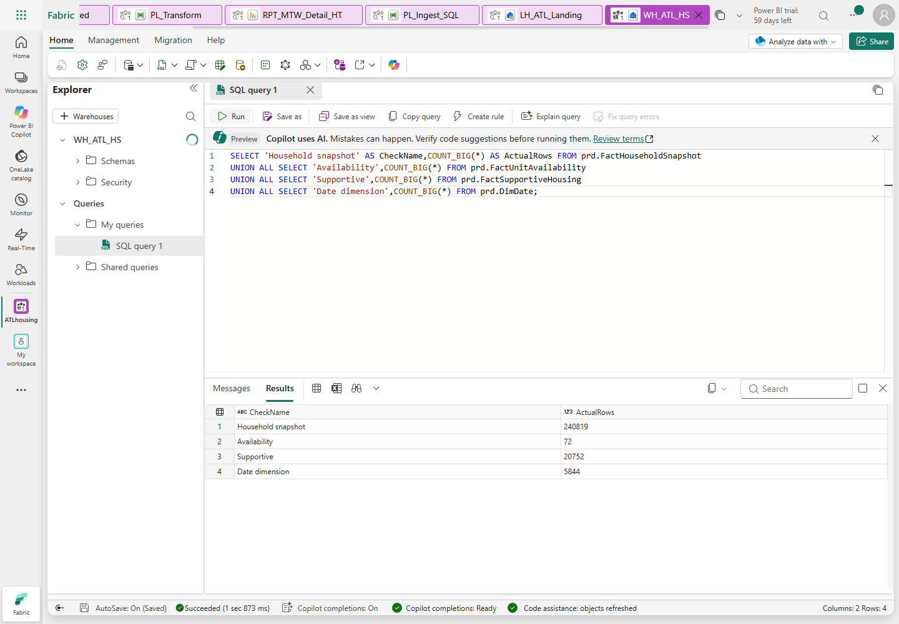

*Figure 12. Counts are an initial checkpoint; the full-outer 17-metric comparison
is the accuracy check.*

### M6.1 Create the transformation notebook and child pipeline

1. Select **New item > Notebook** and name it `NB_Transform`.
2. Attach your `LH_ATL_Landing` as the default Lakehouse.
3. In the first code cell, type
   `warehouse_server = "<WAREHOUSE_SQL_ENDPOINT>"`, replacing the placeholder with
   the Warehouse hostname recorded in M3. Use Python/PySpark, not a SQL cell.
4. Mark this cell as a parameter cell using its **... > Toggle parameter cell**
   command where available.
5. Add another code cell. Paste
   [NB_Transform.py](workshop-assets/notebooks/NB_Transform.py).
   This is manual notebook authoring, not running a local deployment script.
6. Save. Ensure no other publisher is running, choose **Run all**, and wait for
   success. This intentionally repeats the destination transforms idempotently.
7. Create a pipeline named `PL_Transform`. Add **Notebook**, name its activity
   `Transform`, and select **your workspace > NB_Transform**.
8. Set retries to 0; validate and save. Run it once serially and inspect its
   linked notebook execution.

**Check:** three facts, all 17 metrics reconciled, notebook/child pipeline succeeded.
**Stop:** any SQL structural error; keep the exception and fix its cause.
**Catch-up:** repaste the reviewed SQL definitions/cells in your own destination,
then rerun in order; never reload the source database.

## M7. Assemble the base master pipeline and failure handling

**Objective:** wire the manual artifacts and test genuine success/failure states.
M13 later adds DQ and model-framing acceptance to this chain.
EffectiveMonth is validated reporting/control context: this lab still reloads
all 12 supplied months. It is not an incremental SQL or Excel filter.

1. Create pipeline `PL_Master_HouseholdsServed`.
2. Click the empty canvas, open **Parameters**, and add `EffectiveMonth`,
   type **String**, default `2025-01`.
3. Add a **Script** activity named `Validate reporting month`, connection
   **WH_ATL_HS**, script type **NonQuery**.
4. Paste [validate-month.sql](workshop-assets/expressions/validate-month.sql).
5. Add these script parameters as **Input**, type **String**:

| Name, without @ | Dynamic value |
|---|---|
| EffectiveMonth | `@pipeline().parameters.EffectiveMonth` |
| RunId | `@pipeline().RunId` |

6. Add **Invoke pipeline**, named `Ingest SQL`. Select your `PL_Ingest_SQL` and
   enable **Wait on completion**. Connect validation **On success** to it.
7. Add **Dataflow**, named `Ingest approved Excel`; select your real
   `DF_Excel_HouseholdsServed`. Connect SQL **On success** to it.
8. Add **Invoke pipeline**, named `Transform production tables`; select your
   `PL_Transform`, wait on completion, and connect Dataflow success to it.
9. Add **Script**, named `Log master success`, connection WH_ATL_HS, NonQuery.
   Paste [master-success.txt](workshop-assets/expressions/master-success.txt) using
   **Add dynamic content**. Initially connect transform success to this activity.
10. For **each** of the four core stages, add a failure branch. Create a Script
    named `Log failure - <stage name>` and connect the stage's red **On failure**
    output to it.
11. For the failure log, use WH_ATL_HS and NonQuery. Open
    [master-failure.txt](workshop-assets/expressions/master-failure.txt), replace
    `<FAILED_ACTIVITY_NAME>` with that exact stage name, then paste dynamically.
12. After each failure log add a **Fail** activity, named `Fail master - <stage>`.
    Error code: `ATL_HS_STAGE_FAILED`; message: the failed stage name and an
    instruction to inspect its activity details and PipelineRunLog.
13. A logging activity must never turn a failed pipeline into a green success.
    Do not add a success path that bypasses a failed prerequisite.
14. Validate, save and run the base chain once. Record the parent run ID, linked
    SQL/transform child IDs, Gen2 refresh status and total duration.
15. Label this checkpoint **base chain**, not final workshop acceptance. M13 adds
    structural DQ and Warehouse/model reconciliation before success is logged.

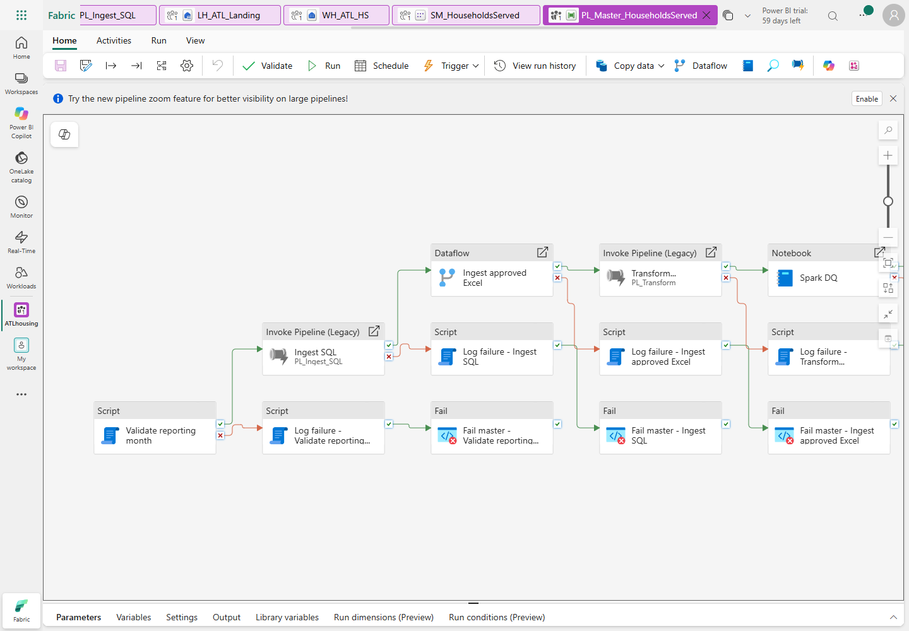

*Figure 13. The reference includes the final M13 stages. Add those later as directed.*

### Safe forced-failure test

1. Ensure no other publisher is active. Run with `EffectiveMonth=2025-13`.
2. Confirm validation fails before SQL/Excel ingestion; inspect the error details.
3. Confirm its failure log succeeds and the explicit Fail activity leaves the
   whole master **Failed**. Downstream ingestion must not run.
4. Inspect the Warehouse log:

```sql
SELECT RunId,Stage,Status,[RowCount],ErrorMessage
FROM mtd.PipelineRunLog ORDER BY StartedAt DESC;
```

5. Restore the normal parameter to `2025-01`.

**Check:** genuine successful base run and genuine terminal failed test with a log.
**Stop:** a failed prerequisite produces a green master, or copies run after an
invalid month.
**Catch-up:** correct connector conditions and wait-on-completion settings.

## M8. Create DimDate, with a supported Copilot fallback

**Objective:** exactly 5,844 dates, 2015-01-01 through 2030-12-31.

1. Ask the instructor whether Copilot is actually available for your account,
   tenant and capacity. The existing F8 assignment alone does not establish this.
2. **Default supported path:** in the Warehouse open a new SQL query, paste
   [04_dimdate.sql](workshop-assets/04_dimdate.sql) and run it manually.
3. If Copilot is available and the instructor chooses that exercise, create
   Dataflow Gen2 `DF_DimDate` and open Copilot. Use this prompt:

```text
Create a date table from 2015-01-01 through 2030-12-31 inclusive.
Include Date, integer DateKey (yyyymmdd), CalendarYear, MonthNumber,
QuarterNumber, ISOWeek, MonthYear (yyyy-MM), QuarterYear,
MonthStartDate, and locale-independent IsWeekend (Yes/No).
AgencyFiscalYear must remain nullable until the agency supplies its rule.
Return 5,844 unique dates. Do not assume calendar year is the fiscal year.
```

4. Review the generated M and types before running anything. Choose destination
   `WH_ATL_HS.prd.DimDate`, correct types, and Replace. Do not execute both paths
   concurrently or create two competing date-table feeds.
5. Verify in the Warehouse:

```sql
SELECT COUNT(*) AS Dates,COUNT(DISTINCT DateKey) AS DistinctKeys,
       MIN([Date]) AS FirstDate,MAX([Date]) AS LastDate
FROM prd.DimDate;
```

**Check:** 5,844 / 5,844 / 2015-01-01 / 2030-12-31.
**Stop:** a generated table ends in 2025 or guesses the agency fiscal year.
**Catch-up:** use the reviewed SQL fallback. Approved fiscal logic is a later,
explicit business decision, not a reason to invent a value.

## M9. Create and configure the explicit Direct Lake model

**Objective:** a dimensional semantic model, not an assumed default model.

### M9.1 Select tables and relationships

1. In your workspace select **New item > Semantic model > OneLake catalog**.
   Select your **WH_ATL_HS** Warehouse as the supported OneLake source.
   This is the **Direct Lake on OneLake** creation route, not Get data's generic
   Power Query/Import route or the SQL analytics endpoint's Direct Lake on SQL route.
2. Name it `SM_HouseholdsServed`, choose your assigned workspace, and select
   these production tables:
   DimDate, DimProgramType, DimVoucherType, DimActionType, DimIncomeSource,
   DimProperty, DimUnit, FactHouseholdSnapshot, FactUnitAvailability,
   FactSupportiveHousing and DQ_Results.
3. Include the physical **mtd.ProgramScope** security map as the only metadata
   table. Do not include AnswerKey, source Member/FamilyMember or other staging tables.
4. Choose **OK** to create, then check a table's **Properties > Storage mode**:
   it must be Direct Lake. If the catalog route is not available, stop and ask
   the instructor; do not silently create Import or accept DirectQuery as equivalent.
5. Open the model. Select **Viewing > Editing** before authoring.
6. Select **Manage relationships > New relationship** (or drag matching key fields).
   Create the following active relationships. Dimension is the **one** side,
   fact the **many** side; cross-filter direction is **Single**, dimension to fact:

| Dimension key | Fact key |
|---|---|
| DimDate.DateKey | FactHouseholdSnapshot.EffectiveDateKey |
| DimProgramType.ProgramTypeKey | FactHouseholdSnapshot.ProgramTypeKey |
| DimProperty.PropertyKey | FactHouseholdSnapshot.PropertyKey |
| DimUnit.UnitKey | FactHouseholdSnapshot.UnitKey |
| DimVoucherType.VoucherTypeKey | FactHouseholdSnapshot.VoucherTypeKey |
| DimActionType.ActionTypeKey | FactHouseholdSnapshot.ActionTypeKey |
| DimIncomeSource.IncomeSourceKey | FactHouseholdSnapshot.IncomeSourceKey |
| DimDate.DateKey | FactUnitAvailability.EffectiveDateKey |
| DimProgramType.ProgramTypeKey | FactUnitAvailability.ProgramTypeKey |
| DimDate.DateKey | FactSupportiveHousing.EffectiveDateKey |
| DimProgramType.ProgramTypeKey | FactSupportiveHousing.ProgramTypeKey |

7. Do not relate facts to each other, connect FamilyMember directly to the snapshot,
   or add an extra active DimUnit-to-DimProperty relationship.
8. Select **DimDate.MonthYear > Sort by column > MonthStartDate**. Format Date as
   a date. Right-click DimDate > **Mark as date table** and choose its Date column.
   Set key columns to **Do not summarize** and hide surrogate keys.
9. Use **Edit tables** / the source-table column selection to remove unneeded
   HouseholdID, MemberKey, SourceUnitKey and PropertyManager columns from the model.
   This report is aggregate-only. Do not remove required relationship keys.
10. Keep names, DOB, ethnicity, citizenship, income and street addresses out of the
    model. If the current web editor cannot exclude an unneeded source column,
    stop for the instructor to provide an approved projection; hiding is not a
    security substitute.

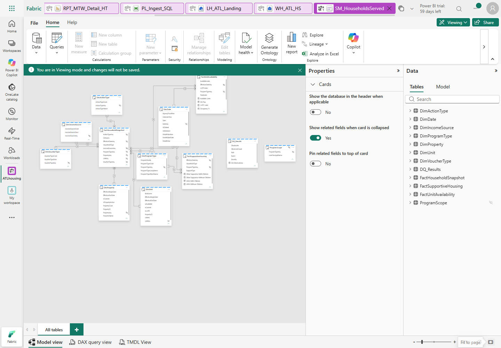

*Figure 14. Use Fit to page to inspect all tables; every relationship has one-direction filtering.*

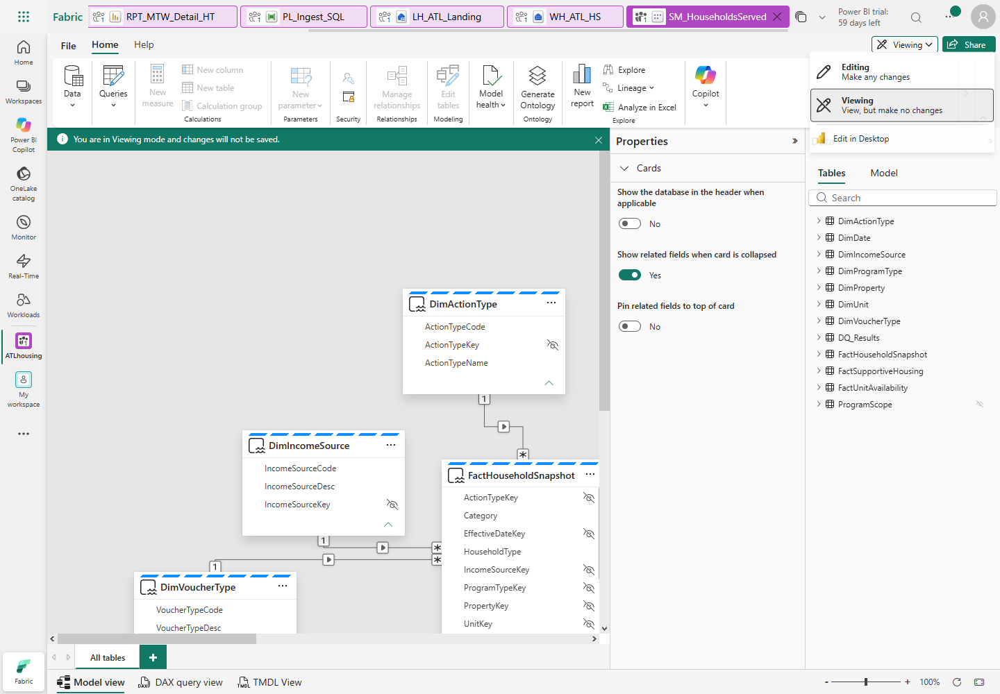

*Figure 15. Switch to Editing to author relationships/measures. Merely viewing is not editing.*

### M9.2 Add actual model measures, one at a time

1. Select the table named in the file's first comment, then **New measure**.
2. Open each matching file under `workshop-assets\dax`, paste its formula into
   the formula bar, and confirm with the checkmark/Enter.
3. Do not paste a whole `DEFINE MEASURE` query into the measure formula bar.
   These files are already individual, persistent measure definitions.

| Owning table | Measure files to add |
|---|---|
| FactHouseholdSnapshot | Households, Households-With-Children, Households-Without-Children, Elderly-Households, Disabled-Households, Workforce-Households |
| FactUnitAvailability | Available-Units, LIHTC-Units, Total-Units, Unit-Based-Households, Vacant-Units, Occupancy-Percent, DQ-Flag, Vacancy-Color |
| FactSupportiveHousing | VASH-With-Children, VASH-Without-Children, Other-Supportive-With-Children, Other-Supportive-Without-Children |
| DQ_Results | DQ-Observations |

4. Set count/unit measures to whole-number format. Format Occupancy % as a
   percentage. Vacancy Color and DQ Flag return text, not numeric sums.
5. Do not replace `COUNTROWS` with distinct HouseholdID counting. The source's
   planted second-program observations are intentional.
6. Open **DAX query view**, paste [reconcile.dax](workshop-assets/dax/reconcile.dax)
   and choose **Run**.
7. Expect 27 program-month rows: January, July and December, nine programs each.
   Compare all 17 output metrics, not just Households, with the same keys in
   `stg.AnswerKey` / `data\controls\answer_key.csv`.
8. A full metric/key comparison is also performed by the manually authored
   NB_Reconcile in M13. Do not sign off model acceptance solely from a row count.

### M9.3 Configure RLS only with an approved mapping

1. Ask the instructor for the approved Viewer UPN and allowed program codes.
   **Do not guess identities or grants.** If none are approved, record this
   security acceptance as Pending and do not grant consumer access.
2. In your Warehouse, open
   [08_approved_program_scope.sql](workshop-assets/08_approved_program_scope.sql).
   Replace the two explicit placeholders with the approved Viewer UPN and program
   code, run it manually, and inspect its returned grant. Repeat only for each
   additional approved program. Do not commit populated identities to Git.
3. Keep ProgramScope disconnected and hidden in the model.
4. In model Editing mode choose **Security / Manage roles**, create `ProgramScope`.
5. Select **Switch to DAX editor**. Set the DimProgramType filter to
   [ProgramScope.dax](workshop-assets/dax/ProgramScope.dax).
6. Add this filter on ProgramScope itself:

```text
LOWER(ProgramScope[UserPrincipalName]) = LOWER(USERPRINCIPALNAME())
```

7. Save the role. An unmapped role member must see no programs.
8. Have the authorized owner assign the approved user to the role and grant
   appropriate model/report access. Do not make them Contributor to bypass RLS.
9. Test **View as**, then an actual **Viewer** session. Verify household,
   availability and supportive facts; also test an unmapped user sees no programs.
10. Record the actual result. An author/Admin view or an unassigned role is not
    proof of Viewer enforcement.

**Check:** Direct Lake partitions, 11 active single-direction relationships,
actual measures and three-month reconciliation. RLS sign-off requires a Viewer.
**Stop:** many-to-many, unexpected Import/DirectQuery, missing keys or unapproved grants.
**Catch-up:** compare the settings/table list with the reference; do not run the model deployer.

## M10. Author the HT1-HT10 report manually

**Objective:** recreate the three matrices and DQ/definition pages from your model.

### M10.1 Create the report and strict month slicer

1. In your semantic model select **New report**. Save it as `RPT_MTW_Detail_HT`
   in your assigned workspace.
2. Add a title text box: `ATL Housing | Households served`.
3. Add a **Slicer** visual; drag **DimDate.MonthYear** into its field well.
4. In slicer formatting choose **Dropdown**, enable **Single select** and
   disable **Select all**. Keep exactly one selected month.
5. In the visual Filters pane add DimDate.CalendarYear and select `2025`, so the
   slicer does not offer years outside the supplied demo snapshot.
6. Select `2025-01`. Test Ctrl-click on a second month: the slicer must still have
   exactly one selected month. If not, correct the single-select control before
   relying on report totals.
7. Use **Edit interactions** if necessary; the month must filter all three matrices.
   It intentionally does not filter disconnected run-level DQ controls.

### M10.2 Occupied household category matrix

1. Add **Matrix**. Rename/title it `Occupied households`.
2. Add Rows, in order: FactHouseholdSnapshot.HouseholdType, then Category.
3. Add Columns: DimProgramType.ProgramTypeShortName.
4. Add Values: **Households** measure, not a summed key or distinct HouseholdID.
5. Select the visual's **Expand all down one level in the hierarchy** button
   so both category levels are visible.
6. Keep household-type subtotals and the grand total visible.
7. Exclude a structural blank ProgramTypeShortName in a report-level filter;
   do not exclude the real unknown-unit observations.
8. January grand total must be **19,998**; With children **7,635** and Without
   children **12,363**. Category precedence is Elderly > Disabled > Workforce,
   regardless of the labels' alphabetical display order.

### M10.3 Inventory matrix, row metrics and negative-vacancy formatting

1. Add another Matrix. Columns: ProgramTypeShortName.
2. Values: Available Units, LIHTC Units, Total Units, Vacant Units.
3. Open **Format visual > Values > Options** and turn **Switch values to rows**
   On. The four metrics should be rows, not repeated columns under each program.
4. In **Cell elements / Specific column**, apply settings to **Vacant Units**.
   Enable font color and select **fx**.
5. Choose **Format style: Field value**, based on measure **Vacancy Color**.
   Apply to values and totals where offered.
6. Verify real rendered cells: January Mixed-Homeflex **-37** and Mixed-RAD
   **-75** must be red. A saved color expression alone is not evidence.
7. Preserve NULL voucher inventory/vacancy. Do not fill it with zero, and do not
   subtract voucher households from the unit-based grand total.
8. January totals: Available **10,798**, LIHTC **2,770**, Total **13,568**,
   Vacant **1,197**.

### M10.4 Supportive matrix

1. Add a third Matrix. Columns: ProgramTypeShortName.
2. Values: VASH With Children, VASH Without Children, Other Supportive With
   Children, Other Supportive Without Children.
3. Again turn **Switch values to rows** On.
4. January grand totals must be **22**, **120**, **606**, **973**, in that order.
   They come from the original roster, not answer-key facts.

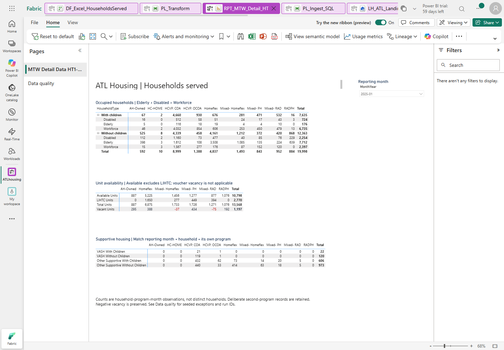

*Figure 16. Actual reference output. Negative vacancy remains visible and red.*

### M10.5 Definitions tooltip, DQ page and actual timing

1. Add a page named `Metric definitions`. In its canvas/page settings select
   **Tooltip** page type/size and allow the page to be used as a tooltip.
2. Add text defining observation grain, child rule, category precedence,
   available versus LIHTC, and non-applicable voucher vacancy.
3. Hide this page from normal report navigation.
4. On occupied/inventory visuals choose **General > Tooltips > Report page**,
   then select Metric definitions. Hover a cell to verify the real tooltip.
5. Add a normal page named `Data quality` with a table visual.
6. Add DQ_Results.RunId, Rule, Severity, CheckedAt and the **DQ Observations**
   measure. Sort CheckedAt descending. Do not sum rule counts across historical runs.
7. The table may be empty until M13 runs. Do not paste fake DQ results to fill it.
8. Add a main-page note: counts are household-program-month observations;
   negative vacancy is a DQ signal, not a value to hide.
9. If an existing sensitivity label is approved and you have permission, apply
   it to the report/model. Otherwise record Pending; never invent a label.
10. Save the report with January selected and the household categories expanded.
11. In Editing mode open **Optimize > Performance analyzer**, start recording,
    refresh visuals and switch January -> July -> December -> January.
12. Record/export the actual visual durations and your test conditions. Target:
    under 3 seconds per workshop visual at demo scale. Do not claim a cold-cache
    or full-page result from a DAX API/token roundtrip.
13. Reference browser warm month interactions were about 0.41 seconds, but full
    page reload was 3.94 seconds and cold-capacity acceptance remains open.
    Your measured result, not these reference numbers, is your performance evidence.

**Check:** correct month/category totals, inventory/null behavior, actual red cells,
supportive totals, tooltip and saved pages.
**Stop:** all-month totals, collapsed categories, Ctrl multi-select or black negatives.
**Catch-up:** rebuild the visual field wells and formatting manually; do not import the report as a substitute for this exercise.

## M11. Optional presenter lab: mirroring versus shortcuts

**Gate:** approved connections, source-owner permission and prerequisites. This
module is not required to manufacture missing data or bypass access controls.

### M11.1 ADLS Gen2 shortcut, without a second ingestion feed

1. In the assigned Lakehouse, open **Files** and choose **New shortcut**.
2. Choose **Azure Data Lake Storage Gen2** and an approved organizational connection.
3. Storage endpoint: `https://fabridemo.dfs.core.windows.net`.
   Select container `atldemo` and the instructor-approved path, such as `csv`.
4. Give the shortcut a clearly separate name, for example `reference_csv_shortcut`.
   Do not place it inside the approved Excel batch or change CurrentBatch to glob it.
5. Create only with approved access, browse a safe lookup CSV, and verify data is
   read through the shortcut rather than another copied staging feed.
6. Do not use the encrypted source Excel files as a workaround for M5.

### M11.2 Azure SQL mirroring, presenter-owned disposable source only

1. Instructor checks supported database features/tier, logical-server identity,
   network access and mirroring prerequisites before creation.
2. Only if the source owner has approved the necessary configuration, select
   **New item > Mirrored Azure SQL Database**, name it `MIR_ATL_HS`, choose the
   approved connection/database and the selected `hs` tables.
3. Start only after approval and inspect replication status until actually Running.
4. Query its SQL analytics endpoint and reconcile sample keys/totals.
5. The draft's source Member update is **not authorized on this existing source**.
   Demonstrate CDC only on an explicitly approved disposable copy; otherwise
   observe existing replication without modifying a source row.

| Pattern | What moves | Use when |
|---|---|---|
| Pipeline | Copies data into controlled landing/staging | Explicit metadata, transformations and run control |
| Azure SQL mirroring | Replicates source data/changes into OneLake | Managed low-ETL replication; not literally zero-copy |
| ADLS shortcut | References data in place | Reuse existing storage with approved access |
| Mirrored Unity Catalog | Syncs metadata and exposes shortcuts | Reuse supported Databricks-managed tables |

**Check:** actual read/status evidence or an explicit prerequisite-blocked entry.
**Stop:** unapproved source configuration/update, keys/SAS or a new paid resource.
**Catch-up:** presenter walkthrough; do not mark a module Delivered from a diagram.

## M12. Governance and DevOps, administrator/presenter-gated

**Objective:** practise approved controls without changing source data or publishing privately owned material publicly.

### M12.1 Labels, Viewer access and lineage

1. With the administrator, confirm the approved existing label and groups.
2. Apply the label to Warehouse/model/report only where supported and authorized.
3. As the approved Viewer, verify RLS from M9. Author access is not an RLS test.
4. If export is approved, export a safe aggregate visual to Excel and inspect
   actual label inheritance. Do not infer inheritance from the label's name.
5. Open workspace **Lineage** and identify Warehouse -> model -> report and
   pipeline/dataflow dependencies that the service exposes.
6. Open **Monitor** and the approved **Capacity Metrics** app. Locate your own
   workload and inspect failures/throttling; do not resize the shared F8.

### M12.2 Private Git integration

1. In the assigned development workspace open **Workspace settings > Git integration**.
2. If the tenant supports the selected provider and you have authorization, connect
   the instructor-approved private GitHub repository, branch and directory.
3. Review the initial synchronization direction before committing or updating.
   Do not overwrite the reference workspace with a different branch.
4. Make a harmless approved lab edit, inspect the pending diff, commit, and
   demonstrate an update from the approved branch.
5. Record unsupported items and secrets exclusions. A local Git commit alone is
   not evidence of a connected Fabric Git integration.
6. Private-repository links require authorized GitHub access. Participants without
   it use the instructor-provided offline pack; a public Pages site is not created.

### M12.3 Dev/Test/Prod deployment pipeline

1. Only after the administrator provides approved Dev, Test and Prod workspaces
   and capacity assignments, create a **Deployment pipeline**.
2. Assign the three approved workspaces to the correct stages.
3. Compare Dev to Test, review the supported items, and deploy to **Test**, not Prod.
4. Rebind Test connections, Lakehouse/workspace IDs, notebook parameters and
   model/report references. Do not let Test publish to Dev staging.
5. Run Test reconciliation and inspect Test lineage. Record unsupported/skipped
   items instead of assuming they deployed.

**Check:** actual control/sync/deployment evidence, or explicit Pending approvals.
**Stop:** guessed groups, invented labels, public publishing or unapproved target workspaces.
**Catch-up:** instructor demonstration; keep the private manual lab pack.

## M13. Spark DQ, reconciliation and the final master acceptance run

**Objective:** detect seeded defects, fail structural errors and prove the final
Warehouse and Direct Lake outputs after a real orchestrated refresh.

### M13.1 Author and run NB_DQ_Checks

1. Create a Notebook named `NB_DQ_Checks`; attach your LH_ATL_Landing.
2. Create a first Python parameter cell with your Warehouse server hostname,
   as in M6. Do not use the Azure SQL source hostname.
3. Paste [NB_DQ_Checks.py](workshop-assets/notebooks/NB_DQ_Checks.py) in a second
   PySpark/Python code cell, save, and choose **Run all**.
4. It reads through the Fabric Spark Warehouse connector and writes actual
   run-scoped results into prd.DQ_Results. Do not run this as local desktop Python.
5. Inspect the real notebook result and the Warehouse table:

```sql
SELECT RunId,[Rule],ObservedCount,Severity,CheckedAt
FROM prd.DQ_Results ORDER BY CheckedAt DESC;
```

| Rule | Expected reference observation | Interpretation |
|---|---:|---|
| DuplicateProgramHouseholdMonths | 450 groups, 50 households | Seeded warning; retain observations |
| MissingUnitObservations | 10 observations, 5 households | Seeded warning; unknown key retained |
| OverOccupiedProgramMonths | 24 | Exactly MIXED_HF and MIXED_RAD across 12 months |
| InvalidMonthlyDates | 0 | Structural error if positive |
| InvalidCurrentPropertyVersions | 0 | Structural error if positive |
| OverlappingPropertyIntervals | 0 | Structural error if positive |

6. Scope should be SQL+Excel after M5. `OccupancyExcelBlocked` means Excel is
   unavailable; it is not a passing occupancy test.
7. Refresh/open the report's Data quality page. Verify actual rule names,
   timestamps, counts and run IDs; do not sum old runs together.

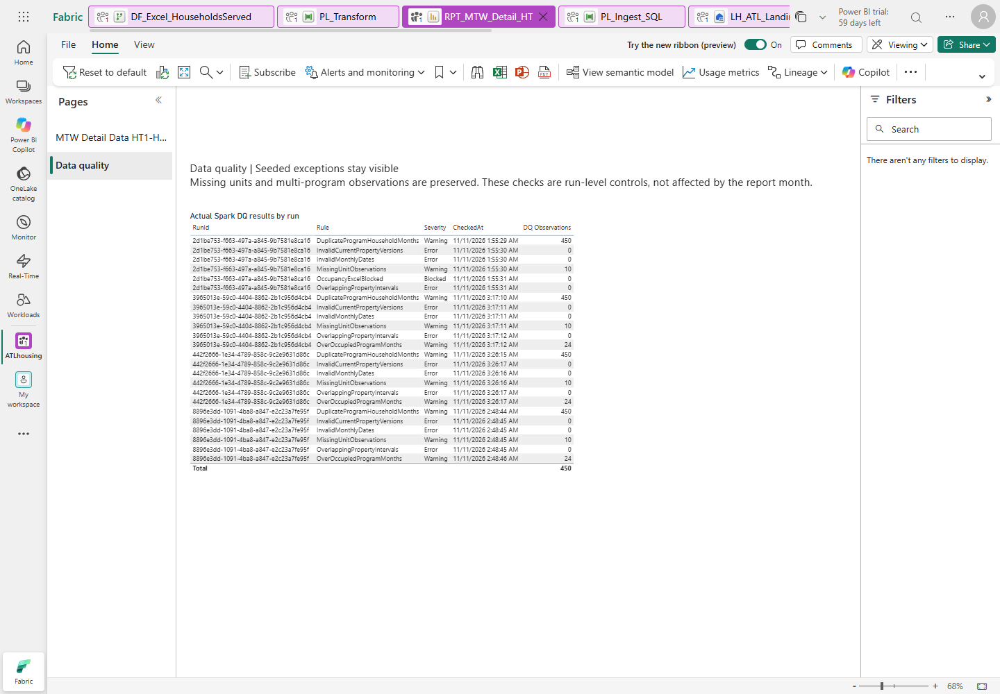

*Figure 17. Seeded warnings stay visible; zero structural counts are not hidden.*

### M13.2 Author NB_Reconcile and frame Direct Lake

1. Create Notebook `NB_Reconcile` and attach your Lakehouse.
2. For its first cell paste
   [parameters.py](workshop-assets/notebooks/parameters.py).
3. Replace all three placeholders: Warehouse server hostname, workspace ID and
   semantic-model ID. Keep the complete supplied reconciliation_dax string.
4. Mark this cell as the parameter cell where available.
5. In a second code cell paste
   [NB_Reconcile.py](workshop-assets/notebooks/NB_Reconcile.py), then save.
6. Run all cells. The notebook must compare all 108 Warehouse keys/all 17 metrics,
   request an actual semantic-model framing refresh, wait for it to complete, then
   compare 27 January/July/December DAX keys/all 17 metrics.
7. Inspect its actual JSON exit result and logged run. Any key, metric, duplicate,
   permission or refresh error must fail the notebook, not return a fabricated success.

### M13.3 Complete the master and run it end to end

1. Reopen PL_Master_HouseholdsServed.
2. Remove the success dependency directly from Transform to Log master success.
3. After `Transform production tables`, add a **Notebook** activity `Spark DQ`,
   selecting your NB_DQ_Checks.
4. After its success add **Notebook** `Reconcile and frame Direct Lake`,
   selecting your NB_Reconcile.
5. Connect reconciliation success to `Log master success`.
6. Add the same **failure log -> explicit Fail** pattern for both new notebook
   stages. Keep the original stages' failure branches.
7. Validate and save. Ensure there are no simultaneous local, Gen2 or pipeline
   publishers. Run with EffectiveMonth `2025-01`.
8. Open **View run history**, choose the actual run, and inspect its stage details.
   Open linked child pipeline, Gen2 and notebook executions.
9. Wait for final **Succeeded/Completed**. Record all IDs in the sign-off sheet.
   The reference successful master took about 7 minutes 19 seconds; your timing
   is capacity-dependent and is not guaranteed.
10. Rerun `07_validate_all_metrics.sql` manually. Then run the model reconciliation
    query again and verify the January/July/December report totals.
11. A momentary OneLake security/schema-propagation message after rebuild/framing
    should be diagnosed from its actual details. Wait and retry after framing;
    do not weaken RLS or permissions to hide it.

### M13.4 Approved alert and scheduling exercises

1. Ask for the approved Teams channel or Outlook recipient and connection.
   If none is provided, mark **outbound delivery Pending**; failure logs alone
   do not prove alert delivery.
2. Only after approval, add the supported Teams/Outlook activity to each failure
   path. Include master run ID, failed stage and a link to run details.
3. Keep an explicit terminal Fail. If an alert fails, it must not mask the
   original failure or turn the master green; use completion/failure handling.
4. Run the invalid-month test again and verify actual receipt with the recipient.
5. Open **Schedule**. Prepare daily **06:00, Eastern Time (US & Canada)** with its
   daylight-saving-aware zone, not a fixed UTC-05 offset.
6. Keep scheduling disabled until the administrator/user approves enablement and
   a successful dry run. Record start/end dates and source-connection ownership.
7. If enablement is approved, verify a real scheduled run later; a configured
   schedule screenshot alone is not unattended-run acceptance.

**Check:** final seven-stage success chain, real DQ, framing, all metric checks
and an honest alert/schedule status.
**Stop:** missing linked execution, a false-green failure path, unmatched metrics
or unapproved sending/scheduling.
**Catch-up:** fix and rerun only your own artifacts serially; preserve failed run IDs.

## M14. Conditional presenter lab: Azure Databricks Unity Catalog

**Gate:** the supplied guide assigns this to the presenter's separate environment.
No Databricks environment was supplied for the reference build, so this module
has no fabricated screenshot or claimed completion.

1. Presenter confirms an approved Databricks workspace, catalog `atl_hs_uc`,
   schema `gold`, supported Delta tables and the required source/Fabric permissions.
2. In the approved presenter Fabric workspace select **New item > Mirrored Azure
   Databricks catalog**, name it `MIR_ATL_UC`.
3. Choose an approved organizational/service-principal connection, select
   `atl_hs_uc` and `gold`, and keep approved automatic metadata synchronization on.
4. Inspect actual table shortcuts and the SQL analytics endpoint. Explain that
   catalog metadata is synchronized and data is read in place; do not confuse
   it with copying the original SQL workload again.
5. Query safe aggregate household/program/month results and compare with the
   approved expected totals.
6. In the approved Lakehouse add **OneLake shortcuts** to the mirrored catalog's
   supported tables. Use an approved notebook to join aggregate program/month
   keys with Warehouse data, avoiding observation-multiplying joins.
7. Create a separate explicit Direct Lake model on supported mirrored Delta
   tables, add one relationship/measure and a single report visual.
8. Only in an approved disposable presenter schema add a new test table, refresh
   metadata and verify it appears. Do not modify ATL's existing workloads.
9. Discuss UC source grants, Fabric/OneLake permissions and approved identity
   mappings. Do not assume UC grants automatically become equivalent Fabric RLS.
10. Without the presenter environment, record **Blocked: prerequisite not supplied**.
    Do not create a new paid workspace to fill the gap.

## Final attendee sign-off

Fill in actual evidence. **Pending / Blocked / Not tested are valid statuses;
invented success is not.** Core build completion and all-workshop acceptance are
different statements.

| Check | Expected / evidence to record | Your result |
|---|---|---|
| Correct source | ATLHousing; no source changes | __________ |
| Original Excel | 24 originals, exact batch path | __________ |
| SQL staging | All 11 counts from M4 | __________ |
| Real Gen2 | 72 / 20,752; terminal refresh ID | __________ |
| Facts | 240,819 / 72 / 20,752 | __________ |
| Date dimension | 5,844 distinct dates | __________ |
| Warehouse accuracy | 108 keys, 17 metrics, zero mismatches/duplicates | __________ |
| Model accuracy | Explicit Direct Lake; 27 keys, 17 metrics | __________ |
| Report | Jan 19,998; red -37/-75; correct support totals | __________ |
| Interactions | Strict one-month; all three matrices; tooltip | __________ |
| DQ | 450 / 10 / 24 seeded observations, zero structural defects | __________ |
| Final orchestration | Parent/child/Gen2/notebook run IDs; duration | __________ |
| Failure handling | Invalid-month terminal failure and logged stage | __________ |
| Viewer security | Approved map, View as and actual Viewer results | __________ |
| Governance | Approved label/groups; actual inheritance test | __________ |
| Performance | Actual cold/warm visual timings, target <3s | __________ |
| Alerts | Approved destination; actual forced-failure receipt | __________ |
| Schedule | Disabled, or approved actual scheduled-run evidence | __________ |
| Optional M11/M12/M14 | Evidence or named prerequisite gate | __________ |

## Troubleshooting at the point of failure

| Symptom | Manual correction |
|---|---|
| Cannot create/use a connection | Stop for admin sharing/permissions; do not borrow unrelated credentials |
| Workbook password prompt | Use the supplied readable originals; no regeneration or decryption workaround |
| Lookup output is one row/object | Clear First row only; ForEach requires the output.value array |
| Dynamic field shows literal @concat text | Use Add dynamic content; do not paste into a literal-only field |
| COPY path not found | Recheck your own workspace/Lakehouse IDs, Files root and exact current pipeline RunId |
| SQL script parameter missing | Add EffectiveMonth and RunId as Input String script parameters, without @ in their names |
| Source counts correct, metrics wrong | Check dated PropertyID, precedence, missing-unit retention and program-specific supportive join |
| Gen2 preview works but staging empty | Inspect actual published refresh and both existing Replace destinations |
| Missing M query identifier | Query names/parameter names are case-sensitive; use the exact names shown |
| Power Query cannot find worksheet | Check UnitAvailability versus Roster; use the supplied SheetName helper |
| Data model seems stale | Wait for actual framing, then refresh visuals; inspect the exact permission/schema error |
| Report shows 240,819/all-year totals | Select one month and verify slicer interactions/DimDate relationships |
| Ctrl-click adds months | Enable strict single selection in the UI and retest actual behavior |
| Category rows hidden | Expand all down one hierarchy level, then save |
| Metrics appear as repeated columns | Values > Options > Switch values to rows |
| Negative vacancy stays black | Apply conditional font color to Vacant Units values based on Vacancy Color |
| Voucher vacancy shows a number | Restore blank inventory semantics and the unit-based household measure |
| Empty/incorrect DQ page | Run real Spark DQ; use MAX observation measure, run ID and timestamp, not summed history |
| Admin sees all programs | Expected author behavior; test the assigned role as an actual Viewer |
| Fiscal year is blank | Deliberate until the agency confirms its calendar |
| No alert arrived | Check approval, connection, destination and actual delivery; logs are not an alert |
| Capacity throttling | Stagger teams' Spark/master runs; do not upgrade shared capacity without approval |

## Asset index and repeatability notes

All assets are **manual editor inputs**, not commands that deploy the lab.
They must target your assigned Warehouse/workspace only.

| Location in the extracted pack | Use |
|---|---|
| workshop-assets\01_foundation.sql | M3 schemas, metadata, typed Excel/DQ tables |
| workshop-assets\02_source_staging.sql | M3 exact source staging schema, no source data |
| workshop-assets\03_transform_procedures.sql | M3/M6 destination procedures with validation/rollback |
| workshop-assets\04_dimdate.sql | M8 supported date fallback |
| workshop-assets\05_metrics_view.sql | M6 all-17-metric Warehouse view |
| workshop-assets\06_dq_views.sql | M6/M13 DQ views |
| workshop-assets\07_validate_all_metrics.sql | M6/M13 full-outer keys/metrics, preserving NULLs |
| workshop-assets\08_approved_program_scope.sql | M9 approved-only UPN/program mapping, guarded placeholders |
| workshop-assets\expressions | M4 and M7 dynamic-content/editor values |
| workshop-assets\power-query | M5 four individual Advanced Editor queries |
| workshop-assets\dax | M9 individual measures, RLS and reconciliation query |
| workshop-assets\notebooks | M6/M13 manually pasted notebook cells |
| data\excel | Unchanged readable originals, included only in the private distribution pack |
| data\controls | Original AnswerKey/manifest controls, not report fact sources |

The primary SQL feed is the pre-existing source database. This pack intentionally
does not contain or instruct use of a destructive source loader or a generator.
Do not append CSVs as a second SQL feed. Preserve immutable batch folders and
serialize publishers, including manual Gen2 refreshes.

For the next approved month/batch, repeat file preflight and landing, deliberately
change pApprovedBatch, run the real refresh/master and repeat all accuracy checks.
Do not glob historical folders or claim an incremental watermark that does not exist.

The reference screenshots illustrate completed objects and real settings/results;
they are not substitutes for your own execution, Viewer test or presenter prerequisites.

### Official UI references

- [Direct Lake on OneLake creation and web modeling](https://learn.microsoft.com/en-us/fabric/fundamentals/direct-lake-web-modeling).
- [Web model editing, date tables, measures and role assignment](https://learn.microsoft.com/en-us/power-bi/transform-model/service-edit-data-models).
